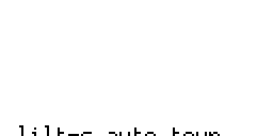
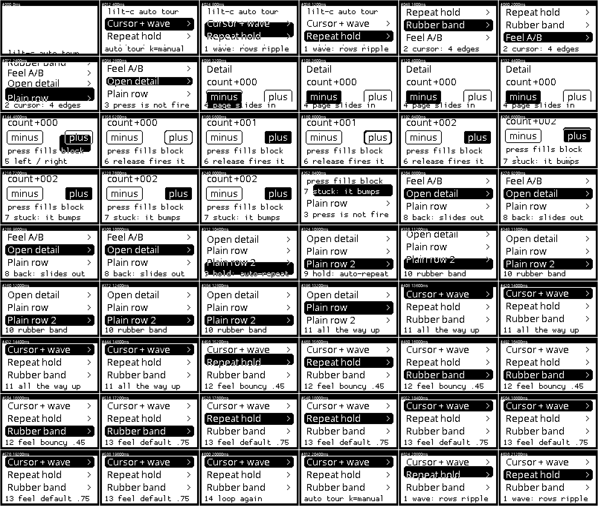
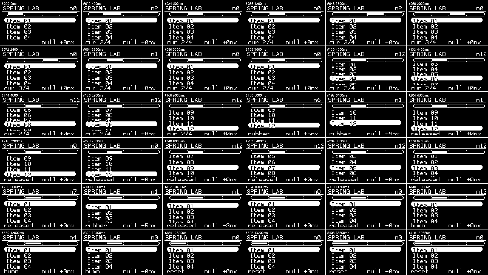
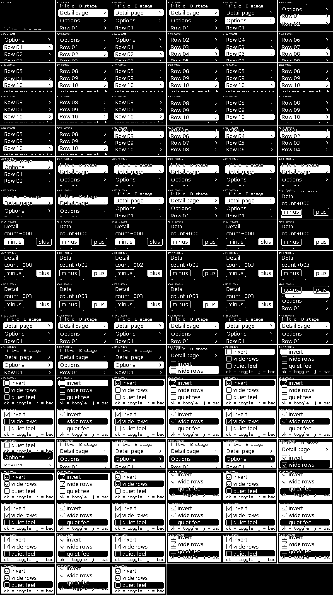

# lilt-c

[chhongzh/lilt](https://github.com/chhongzh/lilt) 是一个用 TinyGo 写的 GUI 框架，它的动画只有一种，就是一支弹簧。列表走焦时的波浪、光标四条边的拉长收拢、页面滑入滑出、滚到底之后的橡皮筋，都是这支弹簧换参数换出来的。

lilt-c 用纯 C 把它重写了一遍，跑在 ESP32-C3 SuperMini 加一块 0.96 寸 I2C OLED 上（SSD1306，128×64）。Go 的接口、闭包和垃圾回收都去掉了，内存全部来自编译期定好的静态池。同一份 `ll_*.c` 在 PC 上无头录帧、在板子上推 I2C，一个字节都不改，硬件只通过 `ll_bus.h` 那六个函数接触。



现在做到 A 阶段（引擎地基）加 B 阶段（手感主体）。文本输入框、编码器、后台任务这些还没做，清单在 [docs/internals.md](docs/internals.md) 末尾。

## 装上

整个文件夹拷进 Arduino 的 libraries 目录，重启 IDE。libraries 在哪看 `文件 → 首选项 → 项目位置`，那个路径下面加一层 `libraries` 就是了。装好之后 `文件 → 示例 → 贡献库 → lilt-c` 下面有三个例子。

菜单里找不到 lilt-c，先确认开发板选的是 ESP32 系列。`library.properties` 里写了 `architectures=esp32`，选中 Uno 时 IDE 会把这个库连同示例一起过滤掉，看起来就像没装上。

Arduino 编库时会递归编译库里所有 `.c` 和 `.cpp`，只跳过 `examples/`。所以 `host/` 下那两个 PC 端源文件被 `#ifdef ARDUINO` 包着，在板子上是空的编译单元，`main()` 不会进固件。

接线四根。

| ESP32-C3 SuperMini | 0.96 OLED |
| --- | --- |
| 3V3 | VCC |
| GND | GND |
| GPIO8 | SDA |
| GPIO9 | SCL |

引脚不一样就改 `ll_conf.h` 里的 `LL_I2C_SDA` 和 `LL_I2C_SCL`，驱动代码不用动。开发板选 ESP32C3 Dev Module。串口一句都不打的话，把 `Tools → USB CDC On Boot` 打开，C3 走的是原生 USB。

## 三个例子

先看 Tour。上电自己动，一圈约 20 秒，把走焦波浪、光标四边、按住连发、橡皮筋、按下反色松手才触发、整页滑入滑出、按钮横跳都演一遍，最后用 MENU 做一次手感 A/B，阻尼 0.75 对 0.45，演完回起点重来。屏幕底部那行小字是段落编号，中文解释走串口。页脚那套小字体一共 95 个字形，全在 ASCII 里，汉字画上去是空位。你随手敲一个键，巡演就停在当场，按键全部交还给你。

SpringLab 是弹簧实验台，四块区域分别演示过冲与阻尼、Ease 和 Spring 的差别、橡皮筋、一列跟着锚点错峰滑回的行走波浪，用来看参数改一下手感怎么变。

Gallery 是三页小应用。首页可滚动列表，详情页两个按钮加一个计数，开关页三个复选框，每个都真的改到界面上，`invert` 互换前景背景，`wide rows` 改行高，`quiet feel` 调阻尼。

Tour 和 Gallery 用同一套引擎同一套控件，区别只在谁按按键。巡演的按键是 `demo_tour.c` 里那张时间表塞进事件环的，走的和你敲串口完全一样的路径。

## 按键

现在没有实体按键，键盘通过串口映射，115200。小写是按下，大写是松开，只发小写的话 90ms 后框架自动当松手，所以直接敲一个 `s` 就是一次点按。

| 键 | 含义 | 键 | 含义 |
| --- | --- | --- | --- |
| `w` `s` `a` `d` | 上 下 左 右 | `空格` 或 `回车` | OK（`x` 是松开） |
| `j` | Back，退一页 | `k` | Menu，换手感档位 |
| `h` | Backspace | 其它可打印字符 | 当字符事件投给输入框 |

按住 0.2 秒开始连发，间隔 0.07 秒起，每次乘 0.9，最短 0.03 秒。

以后接真按键，把 `ll_serial_keys_service()` 那一行换成对每个引脚调 `ll_keypoll_poll(poller, KEY, digitalRead(pin), dt)`，消抖、连发、事件队列全部复用，上层一行不改。

## 画面不对的时候

上下颠倒或者左右镜像，把 `ll_conf.h` 里的 `LL_ROTATE_180` 改成 1。翻转交给面板自己做，`ll_board.cpp` 的 `panel_init()` 发 0xA1 段重映射和 0xC8 COM 反向扫描，引擎不需要知道自己被转了 180 度。

> 这里现在有个 bug 还没改。`ll_bus_push_page()` 里另有一段 `#if LL_ROTATE_180` 的软件翻转，页序、字节序、位序一起倒，和上面两条硬件命令方向相同，两个 180 度叠起来等于没转。`python host/check_panel.py` 会把四种组合都算一遍，只有单用硬件或者单用软件时画面才是对的。修法是删掉那段软件翻转，一共 14 行，删完 SSD1306 和 SH1106 都是 PASS。

右边缺两列，或者整个画面往右偏两列，这块屏是 SH1106。它的显存宽 132 列，把 `LL_PANEL_IS_SH1106` 设 1，驱动就按 SH1106 的时序推页并加 2 列偏移。市面上很多"0.96 寸 12864"其实是这一款。

屏一点不亮，先看串口。开机会扫一遍 I2C 总线并把扫到的地址打出来，扫到 0x3D 就把 `LL_I2C_ADDR` 改成 0x3D，一个都没扫到就查 VCC、GND、SDA、SCL 和 `ll_conf.h` 里的引脚。

太暗就调 `panel_init()` 里 0x81 后面那个对比度字节，现在是 0xCF，往上加。少数模块不带电荷泵，把 `0x8D, 0x14` 改成 `0x8D, 0x10`。

## 自己写一页

```c
#include <Arduino.h>
#include "lilt_c.h"

static LlSerialKeys g_keys;
static uint32_t     g_last_ms;

static void build(LlPage *p)
{
    ll_page_put(p, ll_label_small("my first page"));
    ll_page_put(p, ll_list_item("apple", NULL, NULL));
    ll_page_put(p, ll_list_item("banana", NULL, NULL));
}

LlPage ll_page_mine = { .name = "mine", .build = build };

void setup(void)
{
    ll_serial_keys_init(&g_keys);
    ll_screen_init();                              /* I2C、面板寄存器、总线扫描 */
    ll_pages_boot(ll_screen_api(), &ll_page_mine); /* 顺序有讲究，见 Tour.ino 注释 */
    g_last_ms = millis();
}

void loop(void)
{
    uint32_t now = millis();
    float    dt  = (float)(now - g_last_ms) / 1000.0f;

    g_last_ms = now;
    if (dt > 0.1f) {
        dt = 0.1f;
    }
    ll_serial_keys_service(&g_keys, dt);
    ll_app_frame();
}
```

一个页面就是一个全局 `LlPage` 加一个 `build()`，框架负责根容器、滚动视口、进/出场动画、焦点与光标、方向键走焦、OK 触发、Back 出栈。上面这段能直接编译，`ll_list_item` 的回调传 NULL 就是"选中但点了没事"。

控件清单、间距单位、回调为什么要排进 `ll_app_do` 队列、坐标空间的两套约定，都在 [docs/internals.md](docs/internals.md)。

想在屏上写中文，得换字体。现在这两套是上游 lilt 的 demo 字体裁出来的子集，正文那套 269 个字形里只有 9 个汉字，小字那套一个都没有。`host/tinyfont2c.py` 读 tinyfont 的 Go 源直接吐 C 数组，不需要 Go 工具链，换一套带汉字的进来就能写。

## 不上板先看画面

引擎不碰硬件，所以在 PC 上编译同一份 `.c`，把 `ll_bus` 换成写文件的实现，就能录帧出图。

```sh
sh host/build.sh          # 编译 + 101 项自检 + 录三段帧 + 出 GIF 和概览图
sh host/build-esp32.sh    # 用 Arduino 自带的 riscv32 工具链真交叉编译一遍，报占用
```

录下来的帧就是 SSD1306 的显存格式，页主序，一个字节竖着管 8 个像素，低位在上，所以 PC 上看到的和板子上看到的必然一致。`render.py` 把它们解成 GIF 和概览图，概览图每 12 帧拼一张，一眼看完整个应用。`out/` 不进仓库，README 用的那几张在 `docs/`。

下面三张是概览图，左边起第一格是第 0 帧，往右每格差 12 帧（400 毫秒），一张看完整个应用怎么动。







自检覆盖能算清楚的部分，弹簧过冲比例、Ease 会不会回弹、消抖要几次采样、队列满了丢谁、裁剪和跨页填充的字节、方向导航会不会串到下一行、页面栈的节点回收、巡演字幕有没有超出 128 像素、连演两圈节点池回不回得去。画面对不对还得看图，`docs/internals.md` 里记着两个只有眼睛能发现的 bug。

`build-esp32.sh` 末尾还有一道链接名检查，用 `nm -u` 扫三个 `.ino` 的目标文件，只要出现被 C++ 改写过的引擎名字就失败。`.ino` 按 C++ 编、库里的 `.c` 按 C 编，两边名字对不上时编译器一声不响，要到链接那一步才报 `undefined reference`。

## 目录

```
ll_anim.*     弹簧与 LlValue，唯一的动画原语
ll_geom.*     矩形、向量和几个浮点小工具
ll_gfx.*      LlCanvas，平移、裁剪、圆角、文字
ll_screen.*   1 位页式帧缓冲加脏页检测
ll_font.*     tinyfont 格式的位图字体与度量
ll_input.*    逻辑按键、消抖连发、事件环、串口键位映射
ll_theme.*    主题和五支光标弹簧
ll_app.*      帧循环、do 队列、按键分发
ll_node.*     节点池、盒模型、flex 布局、滚动容器与波浪、方向导航
ll_cursor.*   全局光标，四条边各一支弹簧，反色圆角块
ll_page.*     页面栈、进出场、焦点记忆、默认按键路由
ll_bus.h      唯一的硬件接缝，六个函数
ll_board.cpp  这块接缝的 ESP32 实现，I2C、SSD1306 时序、串口
ll_conf.h     所有可调参数
lilt_c.h      给 .ino 用的总包含，把引擎头包进 extern "C"
demo_*.c/.h   三个示例页面，Tour 巡演、Gallery 相册、SpringLab 实验台
tf_*.c        两套字体，notosans 12pt 正文和 tinysz 8pt7b 小字
tf_font.h     tinyfont 的只读访问层，查字形走二分，一点 RAM 都不占
examples/     Tour、SpringLab、Gallery 三个 .ino
host/         PC 端，host_bus.c、main.c、render.py、check_panel.py、tinyfont2c.py、两个 build 脚本
docs/         README 用的图，加 internals.md
library.properties   IDE 认这个库靠它，architectures=esp32 决定示例菜单在哪些板子下出现
keywords.txt         IDE 的语法高亮词表
```

## 许可

MIT。移植自 chhongzh/lilt，原项目同样是 MIT，动画语义和交互规则沿用，实现是重写的。
